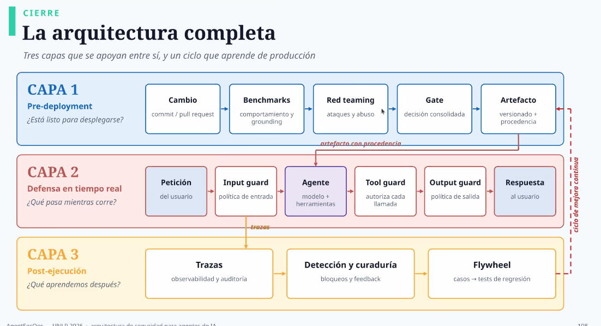

# La arquitectura completa: tres capas y un ciclo

**Fuente:** slide 108 del deck "AgentSecOps · UNLP 2026, arquitectura de seguridad para agentes de IA", según el pie de la slide. La marqué como clave el 29/10.

## La idea

Tres capas que se apoyan entre sí, y un ciclo que aprende de producción. Cada capa responde una pregunta:

1. **Pre-deployment:** ¿está listo para desplegarse?
2. **Defensa en tiempo real:** ¿qué pasa mientras corre?
3. **Post-ejecución:** ¿qué aprendemos después?

Las capas se conectan así:

- El **artefacto con procedencia** que sale de la capa 1 es el agente que corre en la capa 2.
- Las **trazas** de la capa 2 alimentan la capa 3.
- El **flywheel** de la capa 3 vuelve a la capa 1: los casos de producción se convierten en tests de regresión del próximo cambio.

Es el mismo mapa de tres capas que el docente presentó para las evals en la [clase 8](../resumenes/clase-08.md) (offline antes del despliegue, monitoreo en producción y flywheel), mirado ahora desde la seguridad.

## Dónde aparece cada caja en el curso

### Capa 1 · Pre-deployment

| Caja | Qué hace | Dónde lo vimos |
|---|---|---|
| Cambio | Un commit o pull request entra al pipeline | [Clase 8](../resumenes/clase-08.md): los scores alimentan gates con GitHub Actions y MLflow |
| Benchmarks | Miden comportamiento y grounding | [Clases 8](../resumenes/clase-08.md) y [9](../resumenes/clase-09.md): trayectoria y estado final, jueces LLM, pass^k, intervalo de Wilson. Los benchmarks públicos son solo una línea base: hace falta un conjunto propio |
| Red teaming | Prueba ataques y abuso | Garak, PyRIT y Promptfoo, anunciados para el módulo 12 (seguridad) en la [clase 9](../resumenes/clase-09.md) |
| Gate | Toma una decisión consolidada | [Clase 9](../resumenes/clase-09.md): telemetría OpenTelemetry en Langfuse, un score y un gate en GitHub Actions |
| Artefacto | Queda versionado y con procedencia | [Clase 9](../resumenes/clase-09.md): versionado del agente y del juez. [Clase 8](../resumenes/clase-08.md): rollout progresivo (A/B, shadow, canary) |

### Capa 2 · Defensa en tiempo real

| Caja | Qué hace | Dónde lo vimos |
|---|---|---|
| Input guard | Aplica la política de entrada | [Clase 3](../resumenes/clase-03.md): guardrails deterministas antes del LLM (Model Armor, NeMo Guardrails, callbacks de ADK). [Clase 6](../resumenes/clase-06.md): la inyección indirecta por RAG y la ACL en la búsqueda |
| Agente | Modelo más herramientas | Clases [2](../resumenes/clase-02.md) a [5](../resumenes/clase-05.md) |
| Tool guard | Autoriza cada llamada | [Clase 1](../resumenes/clase-01.md): `require_confirmation=True` en las tools irreversibles. [Clase 4](../resumenes/clase-04.md): naming attacks y MCP gateway. [Clase 7](../resumenes/clase-07.md): el LLM no escribe Cypher, elige una tool con una consulta fija |
| Output guard | Aplica la política de salida | [Clase 3](../resumenes/clase-03.md): guardrails después del LLM |

### Capa 3 · Post-ejecución

| Caja | Qué hace | Dónde lo vimos |
|---|---|---|
| Trazas | Observabilidad y auditoría | [Clase 8](../resumenes/clase-08.md): ADK 2 emite OpenTelemetry sin instrumentar a mano. `MODULO_10`: el gap de observabilidad entre lo que el agente hizo y cómo decidió |
| Detección y curaduría | Bloqueos y feedback | [Clase 8](../resumenes/clase-08.md): el drift y las señales que solo se ven en producción |
| Flywheel | Convierte casos en tests de regresión | Clases [8](../resumenes/clase-08.md) y [9](../resumenes/clase-09.md): las trazas reales se vuelven casos nuevos del set de evaluación |
